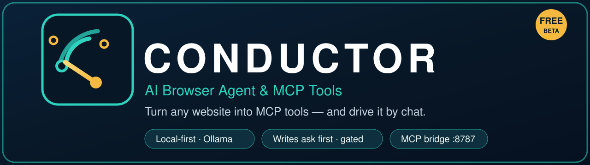
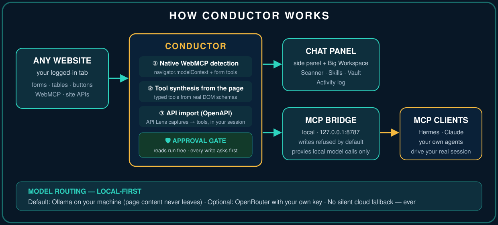
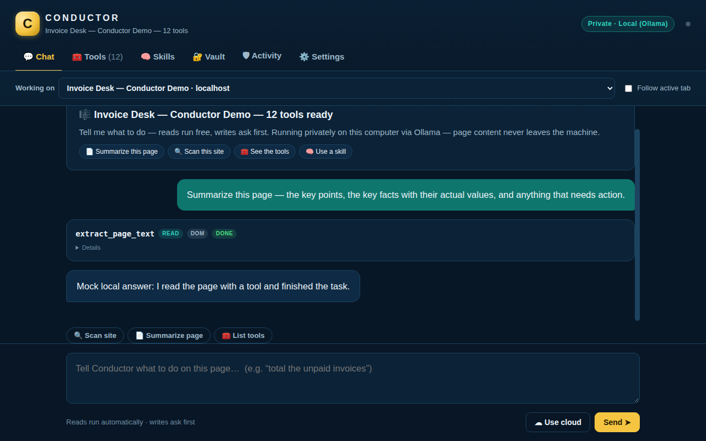
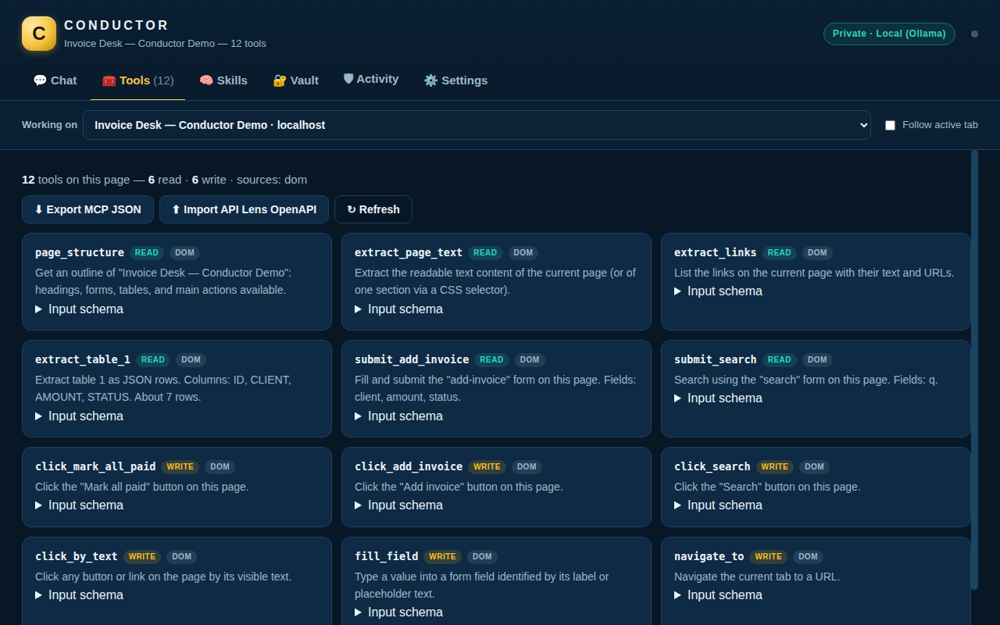
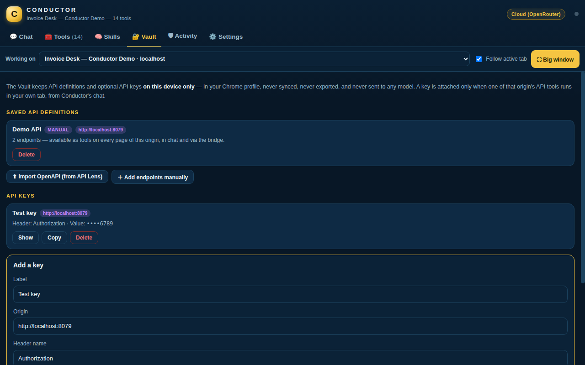
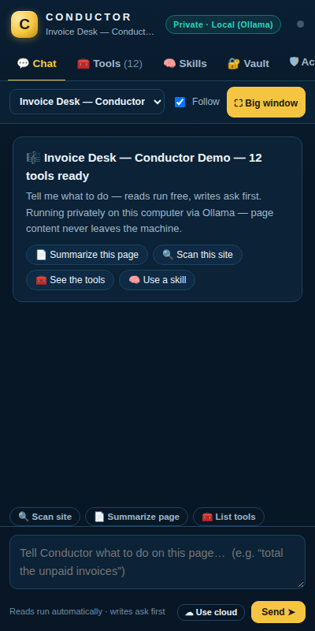

<p align="center">
  
</p>

<p align="center">
  
  
  
  
  
  
</p>

# 🎼 Conductor — AI Browser Agent & MCP Tools

**The web has millions of useful sites and almost no MCP servers. Conductor closes that gap from inside your browser.**

Open any page and Conductor gives it a tool surface an AI can actually use — then lets you drive it from a chat panel, or expose it to *any* MCP client (Hermes, Claude, your own agents) through a tiny local bridge. And it's **local-first**: run Ollama and page content never leaves your computer.

- 🔧 **Tools from any page** — native WebMCP, DOM synthesis, or imported APIs
- 🛡 **Approval-gated chat** — reads run free; every write stops and asks first
- 🔒 **Local-first routing** — Ollama by default, **no silent cloud fallback, ever**
- 🔍 **Site Scanner** — a read-only X-ray of what a page exposes
- 🧩 **Skills Library** — your reusable instruction packs, stored in your browser
- 🗄 **API Vault** — persistent API definitions + per-site keys that never leave the device
- 🌉 **MCP bridge** — any MCP client can drive your real, logged-in session

## How it works

<p align="center">
  
</p>

## The three ways a page gets tools

1. **Native WebMCP** — if the site exposes tools via `navigator.modelContext` (the emerging WebMCP standard), Conductor detects them live, including declarative `<form toolname>` tools, and makes them callable.
2. **Synthesis** — no WebMCP? Conductor reads the page and builds typed tools from what's actually there: forms become fill-and-submit tools with real field schemas, tables become JSON extractors, buttons become click tools, plus universal extract/navigate tools. Works on the 99.9% of the web that has no API and no MCP server.
3. **Import** — recorded a site's real API with API Lens? Import its OpenAPI export and those endpoints become tools too, executed in the page's own context with your session.

## Chat that drives the page — with a gate

The side-panel chat runs an agent loop against the current tab's tools:

- **Read tools run automatically** — extracts, lookups, structure.
- **Write tools stop and ask.** Every click that matters, every form submit, every navigation shows its exact arguments and waits for your Approve/Deny. Denied actions tell the model to stand down.
- **Page content is data, not orders.** The agent is instructed to ignore instructions embedded in pages — and you see every step as a card, live.
- **🛡 Activity tab** — every tool call, approval, denial, route change and error is logged with a timestamp, stored only in your browser. Trust, but verify.

**Big Workspace:** click **⛶ Big window** for the full workspace — a large readable chat, taller composer, wider step/result cards, and a two-column tools grid. The **Working on** picker selects the exact tab Conductor should operate, so the big window can keep focus without losing the page underneath.

## Local-first model routing

Conductor auto-detects **Ollama** on your machine (`127.0.0.1:11434`). If it's running, it's the default route:

- The header badge always shows the live route: **Private · Local (Ollama)** or **Cloud (OpenRouter)**.
- On the local route, page content **never leaves your computer**.
- Prefer a stronger cloud model? Add your own OpenRouter key (free models cost $0). Route preference lives in Settings: Auto (local first) / Local only / Cloud.
- **No silent cloud fallback — ever.** If the local route fails, the chat stops, tells you what failed, and offers *"Use cloud for this task"* as a button. Page data reaches OpenRouter only when you configured a key as your route, or flip that per-chat switch yourself.
- If your Ollama refuses direct extension connections, run the local bridge — it proxies model calls on your machine (and only ever to `127.0.0.1`; it refuses any other URL).

## Site Scanner

One click (**🔍 Scan site**) produces a read-only report card for the current tab: native WebMCP tools found (count + names), synthesized tool count, API endpoints known for the origin, a page inventory (forms, fields, tables, buttons, links, headings), and informational risk flags — password fields, payment-looking forms, file inputs. Scanning never executes a tool.

## Skills Library

Skills are **your** reusable instruction packs, stored only in this browser: *Research this page*, *Extract table to JSON*, *Price watch summary*, and *Page action plan* ship as editable starters, and you can add your own (optionally scoped to one site). Activate one and it guides the chat for that conversation, visibly badged above the composer. Skills are instructions only — they never bypass the write-approval gate.

## API Vault

Imported API definitions stop being throwaway: they live in the **Vault**, named and persistent across tabs and restarts (add endpoints manually too — `GET /path — description`, one per line). You can also save an optional **API key per origin**:

- Keys are stored only on this device, in your Chrome profile — shown masked (last 4), revealed/copied only on your click.
- Keys are **never** in any export (MCP/OpenAPI exports are redacted — there's a unit test that proves it), and **never** sent to a model provider. The model sees tool names and schemas only.
- A key is attached to a throwaway copy of the tool at execution time, inside your tab, only for chat executions you run or approve. MCP bridge calls deliberately run **without** vault keys.
- Delete one key, or clear them all, any time.
- Honest note: Chrome profile storage is protected by your OS account; it is not a separate encrypted vault.

## The MCP bridge

```sh
cd bridge && npm install
node conductor-bridge.mjs
```

Add that command as an MCP server in your client, enable the bridge in Conductor Settings, and any MCP host can list and call the active tab's tools. Bridge calls run **read tools freely; write tools are refused** unless you explicitly enable bridge writes in Settings. (Verified end-to-end: initialize → tools/list → tools/call relay.) The bridge also carries local model calls as a fallback transport (it only proxies to `127.0.0.1` and refuses anything else — verified).

```json
{
  "mcpServers": {
    "conductor": {
      "command": "node",
      "args": ["/path/to/conductor/bridge/conductor-bridge.mjs"]
    }
  }
}
```

## Install

**From this repo (unpacked):**

1. Download or clone this repository.
2. Open `chrome://extensions` → enable **Developer mode** → **Load unpacked** → select the repository folder (the one containing `manifest.json`).
3. Pin 🎼 Conductor. Open the side panel on any page.
4. For chat: run **Ollama** (`ollama pull llama3.1:8b`) for private local chat, **or** paste an OpenRouter API key (free at openrouter.ai) in Settings.

Requires Chrome 116+.

**Chrome Web Store:** listing in preparation.

## Demo (2 minutes)

```sh
cd demo && python3 server.py   # → http://localhost:8079/
```

The Invoice Desk is a fake business app with no API — ask Conductor to *"total the unpaid invoices"*, then *"add an invoice for Maple Dental, $450"* and watch the write gate ask first.

## Screenshots

**Big Workspace — chat, running privately on the local (Ollama) route:**



**The toolset Conductor synthesized from one page:**



**API Vault — saved API definitions and on-device keys, always masked:**



**The side panel — full chat, route badge, quick actions:**



## Pricing

- **Free (beta)** — everything in this build, unlocked. Bring your own model: Ollama locally, or your own OpenRouter key (free models make it $0 to run).
- **Conductor Pro — $12/month** at launch: hosted models (no key needed), saved tool libraries across sites, team sharing, priority support. Flat price — no credits, no per-action charges.

No account. No telemetry. On the local route, nothing leaves your computer at all.

## Safety model — the short version

- Tools are classified **read/write** at synthesis time (heuristics documented in `src/lib.js`); misclassification fails toward *write* (asks) for anything stateful-looking.
- Your model key lives in extension storage on your machine. Captured pages, tools, and results never leave the browser except as chat context **you** send to **your** model.
- The bridge binds to `127.0.0.1` only, and ships with writes disabled.

## Tests

```sh
node --test tests/lib.test.mjs   # 15 tests: synthesis, risk classes, imports, exports,
                                 # routing (local-first, no silent cloud), skills,
                                 # scanner summary, vault model + export redaction
```

Current status: **unit tests 15/15 · bridge E2E 5/5 · browser E2E 23/23** (against a mock Ollama). Also in `tests/`: `mock-ollama.mjs` — a mock Ollama + OpenRouter spy used to prove the routing behaviour (local round-trip; kill local → user is told, **zero** cloud requests; explicit consent → cloud called once).

## Honest limits

- Tool quality tracks page quality: clean semantic HTML synthesizes beautifully; div-soup apps with canvas UIs synthesize poorly (the API-import lane is the reliable path there, via API Lens).
- Elements are tracked per page load; heavy SPAs that re-render between snapshot and call can occasionally stale a click target — the agent re-reads the page and retries.
- Native WebMCP tools registered *before* Conductor's detector loads may be listed without a callable handle; a page reload fixes it.
- The chat loop caps at 8 model rounds per request by design.
- The bridge needs Chrome awake; MV3 service workers sleep, and the bridge reconnects automatically when the browser is active again.
- **Ollama routing is verified against a mock** implementing Ollama's API and origin policy (detection, model listing, tool-calling round-trip, failure path) plus a bridge-proxy run. Some real Ollama builds refuse browser-extension origins (`OLLAMA_ORIGINS`); if yours does, the bridge transport covers you — both paths are fully local. End-to-end proof on a real Ollama install happens on your own machine and is still pending.
- **Per-site allowlist is deferred** — there is no persistent per-origin policy yet; the approval gate and the Activity log are the current trust controls.
- Vault keys rely on Chrome profile storage (see the honest note in the Vault section).

## Privacy

Conductor operates no servers and collects nothing — no analytics, no telemetry. Full policy: **[privacy-policy.html](privacy-policy.html)** (hosted: https://rawcdn.githack.com/EdgeAgent/conductor/main/privacy-policy.html).

## Changelog

**v1.2.0 (2026-11-06)** — First-click fix: the toolbar popup is now a real launcher (page tools, live model route, bridge status) instead of a title-only sliver, and the side panel chrome was compacted (target bar 99px → 54px) with a proper welcome state. Local-first Ollama routing with route badge and a hard no-silent-cloud-fallback rule. Fixed a v1.1 message loop (native-tool announces re-triggering tool fetches) that could wedge tool execution on "running". Site Scanner, Skills library, Activity log, API Vault. Manifest name is now "Conductor — AI Browser Agent & MCP Tools"; one new host permission: `http://127.0.0.1/*` (your own machine only — Ollama + bridge).

## Credits

Synthesis + chat + bridge are original. Sibling project: **API Lens**, the capture-side companion (record a site's API → OpenAPI/clients → import here as tools).

## License

[MIT](LICENSE) © 2026 Kevin Doherty
