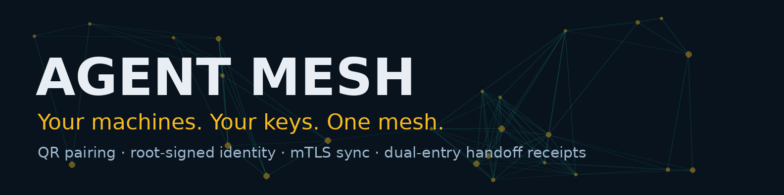

<p align="center">
  
</p>

# Conductor Mesh — the engine

**One product: Conductor. This folder is its local engine.**

Conductor (the extension at the root of this repo) is everything you see — the agent, the chat, and the Mesh tab where you pair devices. But a Chrome extension is not allowed to run a network server, hold a root key outside the browser sandbox, or talk machine-to-machine over mTLS. So Mesh Mode pairs the extension with this small Node daemon over Native Messaging: one download experience, one product, two parts under the hood — the same pattern 1Password and other serious tools use.

What the engine does:

- **Root of trust.** First run creates an Ed25519 root CA in `~/.meshnode` (key stored `0600`). Only the root can enroll a node. Nobody else can mint an identity in your mesh.
- **Pairing by QR.** Conductor's Mesh tab displays a QR code carrying a **one-time token** (10 minutes, single use, in the URL fragment). The joining device generates its own keypair and submits **only its public key**; the root signs it into a node certificate.
- **Private keys never move.** Generated on their device, stored on their device, never returned by any interface. The extension and peers see names and SHA-256 certificate fingerprints — that's it.
- **mTLS with pinned identity.** Node traffic is mutual TLS: the CA chain is validated by TLS **and** the peer's certificate fingerprint is pinned against the peer registry. An address is not an identity.
- **Dual-entry receipts.** Every enrollment, sync, and handoff appends to a hash-chained receipt log. A handoff counts as *proven* only when the sender's `HANDOFF` entry and the receiver's `RECEIPT` entry match on handoff hash + payload hash — each side holds proof the other can't rewrite.

## Install — one command

```sh
# Windows (PowerShell)
irm https://raw.githubusercontent.com/EdgeAgent/conductor/main/mesh/install-mesh.ps1 | iex
# macOS / Linux
curl -fsSL https://raw.githubusercontent.com/EdgeAgent/conductor/main/mesh/install-mesh.sh | sh
```

The script downloads the engine from this repo's `mesh-v1.0.0` release, registers the Native Messaging host with Chrome, and enrolls this machine. Then:

```sh
node daemon.mjs serve        # from the install folder — mTLS :47832 · pairing :47833
```

Install Conductor from the Chrome Web Store, open the **Mesh** tab, and pair your phone or a second machine by QR.

## Manual commands

```sh
node daemon.mjs enroll --name "desktop"     # create the root CA + this node's cert (machine 1)
node daemon.mjs pairing-start               # one-time token + claim URL (machine 1)
node daemon.mjs claim --url http://<machine-1>:47833/pair/claim --token <TOKEN> --name "laptop"
node daemon.mjs sync laptop                 # fetch + verify a peer's receipt chain
node daemon.mjs handoff laptop              # HANDOFF → RECEIPT, returns proven: true
node daemon.mjs verify                      # verify this node's own chain
```

Phones join as companions from Conductor's QR code: the companion page generates the phone's identity in the browser (WebCrypto P-256), enrolls it, and shows live node status with a one-tap proven-handoff test.

## Verified, not promised

The full loop was exercised end-to-end (2026-11-08): two daemons paired via the claim flow, synced over mTLS (peer chain verified), and exchanged a handoff whose dual-entry match was re-verified independently from both chain files. Conductor's Mesh tab connected through real Native Messaging, and a phone-browser companion enrolled by QR and triggered a proven handoff from its own UI. Unit tests: `npm test` (in this folder).

## Honest limits

- **Root key custody.** The root key lives on the enrolling machine in this build; the offline-root ceremony is a documented hardening step, not yet the default.
- **LAN-first.** Pairing assumes you can reach the host (same LAN, VPN, or tunnel). There is deliberately **no public rendezvous server**.
- **Browser companions** authenticate with a node-signed 24h session token (a phone browser can't run an mTLS listener); full nodes always use mTLS.
- **Certificate issuance** shells out to `openssl` (Node 18+ and OpenSSL required).

## Files

| File | Role |
|---|---|
| `daemon.mjs` | The daemon: mTLS server, pairing server, Native Messaging host, CLI |
| `identity.mjs` | Root CA + node certificate issuance (keys never leave the mesh home) |
| `protocol.mjs` | mTLS client: status / sync / handoff with fingerprint pinning |
| `chain.mjs` | Hash-chained receipt log + dual-entry handoff matching |
| `companion.html` | The phone companion page served by the pairing endpoint |
| `install-mesh.*` | One-command install (download + host registration + enroll) |
| `install-native-host.*` | Native Messaging host install only (sh / ps1) |

Covered by this repo's MIT license.
